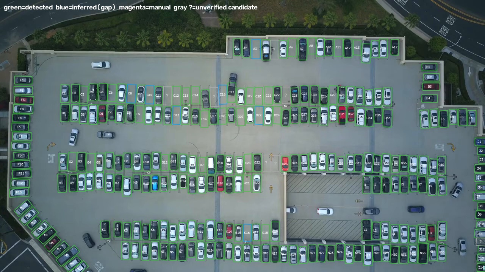

# Tawjeeh: Smart Parking Detection

Tawjeeh (Arabic for "guidance") reads parking lot camera video and marks each spot as available (green), occupied (red), or uncertain (yellow), with live counters, then saves the result as an MP4 video.
Runs on CPU only, with no need for PyTorch or a graphics card.



## Why it exists

Drivers waste time circling parking lots looking for a free spot. Tawjeeh explores how existing camera footage could show open spots without installing a sensor in each one.

## How it works

1. **Read:** load the video and stabilize each frame.
2. **Detect:** find cars with a YOLO model running on ONNX.
3. **Map:** match the detected cars to the saved parking spots.
4. **Decide:** determine each spot's status and keep it steady over time.
5. **Output:** create an annotated MP4, a CSV of the counts, and a JSON summary of each spot.

## Installation (one time)

Requires Git and Python 3.13. Open PowerShell where you want to keep the project, then run:

```powershell
git clone https://github.com/mohmed-tech1/tawjeeh.git
cd tawjeeh
py -3.13 -m venv .venv
.\.venv\Scripts\python.exe -m pip install -r requirements.txt
```

## Usage

```powershell
.\.venv\Scripts\python.exe main.py                  # all videos in the folder and the videos folder
.\.venv\Scripts\python.exe main.py Parking.mp4      # one video
.\.venv\Scripts\python.exe main.py --no-show        # no display window (faster)
.\.venv\Scripts\python.exe main.py --detect-every 2 # detect every 2 frames (for weak machines)
```

Press `Q` to close the display window.

**Output** in the `output\` folder:
- `<name>_result.mp4`: the processed video.
- `<name>_counts.csv`: counters every half second.
- `<name>_summary.json`: final status of each spot.

## Adding a new video

Put the file in the project folder or in `videos\`, then run `main.py`. The first time:
1. Each spot's location is detected automatically, and the settings are saved to `configs\<name>.json`.
2. Review the image `configs\<name>_spots_preview.jpg` to verify them.

Each camera has its own settings. If the camera or angle differs from the settings file, the program refuses to use it.
For another video from the **same camera**, use: `main.py video2.mp4 --config configs\Parking.json`

## Manual calibration (when automatic detection fails, or to correct it)

```powershell
.\.venv\Scripts\python.exe calibrate.py Parking.mp4          # review and edit the detected spots
.\.venv\Scripts\python.exe calibrate.py cam2.mp4 --empty     # fully manual marking from scratch
```

| Action | Function |
|---|---|
| Left-click ×4 | Add a spot (4 corners) |
| Left-click on a gray `?` | Accept a candidate place |
| Right-click | Delete a spot |
| `D` | Copy mode: each click places a copy of the last spot |
| `C` | Accept all candidate places |
| `Z` | Undo |
| `S` | Save |
| `Q` | Exit |

## Files

| File | Function |
|---|---|
| `main.py` | Main entry point |
| `calibrate.py` | Manual calibration tool |
| `tawjeeh\detector.py` | Car detection (YOLO ONNX) |
| `tawjeeh\stabilizer.py` | Image stabilization for camera shake or drone movement |
| `tawjeeh\spots.py` | Automatic spot detection and settings storage |
| `tawjeeh\occupancy.py` | Status detection and temporal smoothing |
| `tawjeeh\render.py` | Drawing and counters |
| `tawjeeh\pipeline.py` | Connects the stages |
| `models\` | Contains `yolo11n-obb.onnx` (for top-down footage) and `yolo11n.onnx` (for ground-level cameras) |
